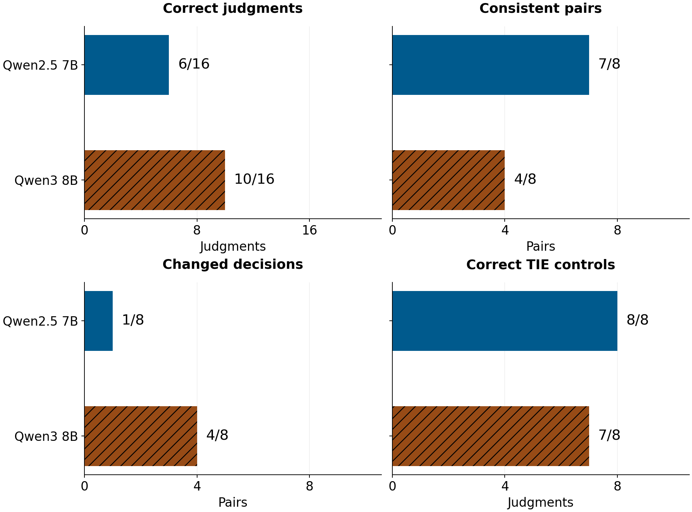

# Code-judge order lab

A preregistered diagnostic of local LLM-as-a-judge decisions: present the same two Python implementations in both A/B orders, then distinguish correctness from order consistency.

This is an original small coding diagnostic, not a replication of MT-Bench, a human-preference experiment, a frontier-model comparison or a production-review benchmark. The model judges fixed code and never repairs or executes it.

## Design

Eight authored contracts cover list chunking, stable deduplication, half-open overlap, clamping, configuration merge, lexical POSIX containment, UTF-8 byte size and timestamp expiry. Every task has a valid implementation, a deliberately flawed implementation, a valid alternative and fixed executable tests. Before any measured inference, all valid/alternative candidates passed and all deliberate mutants failed. Tests explicitly accept ordinary exception subclasses and enforce input preservation where the contract requires it.

Two installed models each receive 16 primary judgments: eight code pairs in canonical and reversed order. Each also receives eight TIE controls: four pairs of valid alternatives and four identical pairs of failing code. Total: 48 fresh chats. The prompt defines TIE as both candidates satisfying the contract or neither satisfying it; this is binary contract evaluation, not stylistic preference. Tests, gold labels, case IDs and model provenance are withheld from each judge request.

Only the exact option strings change positions inside a primary pair. Both models use JSON-schema decoding, temperature 0, seed 20261117, context 8192, output cap 192, think=false and timeout 90 seconds. There are no retries or feedback. The two models run in sequential blocks, with a deterministic within-block shuffle; the first model is unloaded before loading the second. Model digests, templates and installed metadata are pinned in `evidence/models.json`; software versions are in `evidence/versions.json`. No new models, paid APIs or extra services were used.

Read [PROTOCOL.md](PROTOCOL.md), [CANDIDATES.json](CANDIDATES.json) and [SOURCES.json](SOURCES.json). The protocol and 14 scientific files were hashed and committed before measurement. The initial stub was implemented through INVARIANT; protected checks were not changed in response to results.

## Reproduce checks and audit

Python 3.11+ standard library suffices for fixture execution, tests and the independent audit of saved data:

```sh
python3 -B tests/run_checks.py
python3 -B audit.py
```

`audit.py` imports none of `evaluation.py`, `request.py` or `run.py`. It re-executes only the authored fixture programs, reconstructs every gold label and exact prompt, checks every hash and request issuance record, re-parses all saved responses, and recomputes marginal and paired metrics. Model output is never executed. This is not a general sandbox for arbitrary uploaded programs.

For an explicitly requested new inference run, use a fresh clone/working copy, the exact installed model digests and fixed settings in the manifest, and no other resident model. Preserve the published evidence under a new name, then run and audit the new matrix without editing frozen scripts:

```sh
mv results/primary results/published-primary
cp results/audit.json results/published-audit.json
python3 -B run.py measure
python3 -B audit.py
```

The runner refuses to overwrite any prior run. The independent auditor verifies `results/primary`; moving data directories leaves the frozen scientific source unchanged. Preserve both the published and replay evidence. Alternatively, `run.py measure results/replay` can collect into a fresh directory; to audit it in another copy, archive that copy's original primary directory and put the replay there. Do not edit the frozen auditor. Ollama must already contain the pinned models; the scripts never pull one. Machine time and subscription usage still have costs; no dollar estimates are inferred from tokens.

## Metrics and interpretation

- Main correctness is correct judgments /16 per model, split by correct code appearing first or second (/8 each).
- Pair consistency is the same substantive choice after normalizing A/B back to the original implementations (/8). A tie in both orders is consistent. A consistently selected failing implementation remains wrong.
- Changed pairs have two schema-valid but different normalized decisions. Invalid pairs are reported separately; all eight primary tasks remain in the denominator.
- TIE controls are reported /8, split both-valid /4 and both-failing /4. They test this fixed rubric rather than general preference calibration.

No statistical intervals or population bias estimates are calculated from these eight constructed pairs. Always-A/B counts diagnose these observed decisions; they do not establish a stable preference distribution. The single seed, simple hand-authored functions, older quantized local models and specific prompt limit generalization. Rationales are saved but not graded for truthfulness; a correct winner can have an incorrect explanation. The execution tests are finite checks for the authored candidates, not proofs about arbitrary implementations.

## Measured results

| Judge | Correct main judgments | Consistent pairs | Changed pairs | Correct TIE controls |
|---|---:|---:|---:|---:|
| Qwen2.5 7B | 6/16 | 7/8 | 1/8 | 8/8 |
| Qwen3 8B | 10/16 | 4/8 | 4/8 | 7/8 |

Consistency includes TIE in both orders. Qwen2.5 had four such persistent ties on primary pairs where exactly one implementation passed the fixed contract tests. Qwen3 had no persistent TIE pair. Neither judge consistently selected the buggy implementation in both orders. Both orders were correct on 3/8 tasks for Qwen2.5 and 4/8 for Qwen3.

The valid-first and valid-second correctness counts were identical within each model: 3/8 versus 3/8 for Qwen2.5, and 5/8 versus 5/8 for Qwen3. This marginal symmetry does not imply pairwise stability. Qwen3 selected the A label in both orders on one task and the B label in both orders on another; the other two changed pairs included a tie. No population position-preference estimate follows from these eight cases.

All 48 responses were terminal, schema-valid and below the output cap, with no transport failures or active thinking output. Both-valid tie controls were 4/4 and 3/4; both-buggy controls were 4/4 for both models. The separate audit checked 14 frozen hashes, all fixture gold labels, exact prompts/permutations, issuance records and all 48 raw responses. The fixed implementation suite passed 8/8.



Chart alt text: Qwen2.5 7B had 6/16 correct judgments, 7/8 consistent pairs, 1/8 changed pairs and 8/8 correct tie controls. Qwen3 8B had 10/16, 4/8, 4/8 and 7/8 respectively. All values are raw counts from results/audit.json; there are no statistical intervals. The complete per-task pair table is in that JSON file.

`plot.py` renders the PNG and SVG directly from the independent audit. Existing Matplotlib 3.10.3 was used; no dependency upgrade was needed. Model responses were inspected for label/code mismatches and unsupported explanations, but those explanations were not assigned a quantitative quality score. Every erroneous winner remains in its predeclared denominator.

## Tooling and available usage

[INVARIANT](https://github.com/Xenox-developer/invariant) 0.3.1 coordinated implementation of `evaluation.py`, eight fixed acceptance checks, semantic review and guarded application. This role is documented in `evidence/invariant.json` with IDs, validation receipts, resource hashes, execution witnesses and verified delivery. Host scripts then issued the local Ollama calls and independently audited saved evidence. `evidence/development-usage.json` retains complete available INVARIANT worker/reviewer usage; measured local inference token counts are kept separately in `results/audit.json`. Sessions and individual responses are different counts; cached input and reasoning tokens are subsets, not extra usage. Outer chat usage is unavailable. No subscription tokens are converted to monetary claims.

## Primary sources

- Anthropic, *Building strong safety evaluations*, November 13, 2026: https://www.anthropic.com/research/building-strong-safety-evaluations . The source discusses answer-order sensitivity and preregistration. Design and preregistration sections were read; no vendor safety score is reproduced.
- Lianmin Zheng et al., *Judging LLM-as-a-Judge with MT-Bench and Chatbot Arena*, June 9, 2023, revised December 24, 2023: https://arxiv.org/abs/2306.05685 . Abstract, sections 3.3/3.4 and Appendix D.1 were consulted for position swapping, consistency and scope limitations. This experiment uses a different dataset, rubric and models; it is not an MT-Bench result.

All candidate code, tests, synthetic fixtures and measurements are authored for this project and share the included MIT license. Primary pages are linked, not redistributed. Telegram is discovery context only; exports, session files, credentials and account state are excluded from the repository.

Figure tooling reference: Timothy Kassis, Vinayak Agarwal, Yuhuan He, Darshil Patel, Aubrey M. Brueckner (2026), Scientific Agent Skills: A Library of Procedural Knowledge for Research Agents, arXiv:2609.00065 (current record v2, checked November 17, 2026): https://doi.org/10.48550/arXiv.2609.00065 . The installed Matplotlib procedural skill informed figure construction; it is not evidence for the model results.
